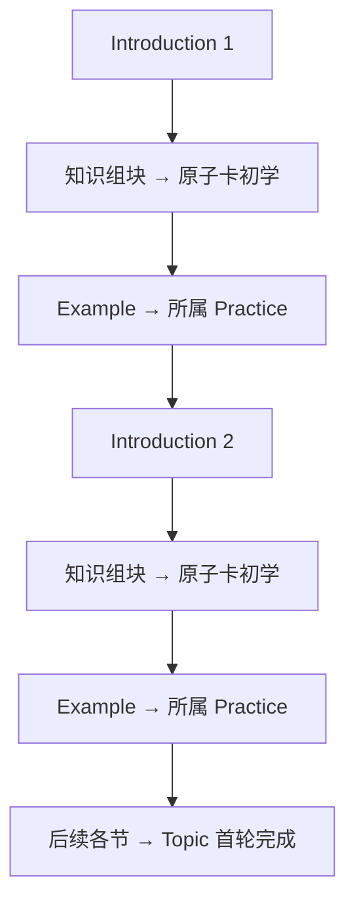
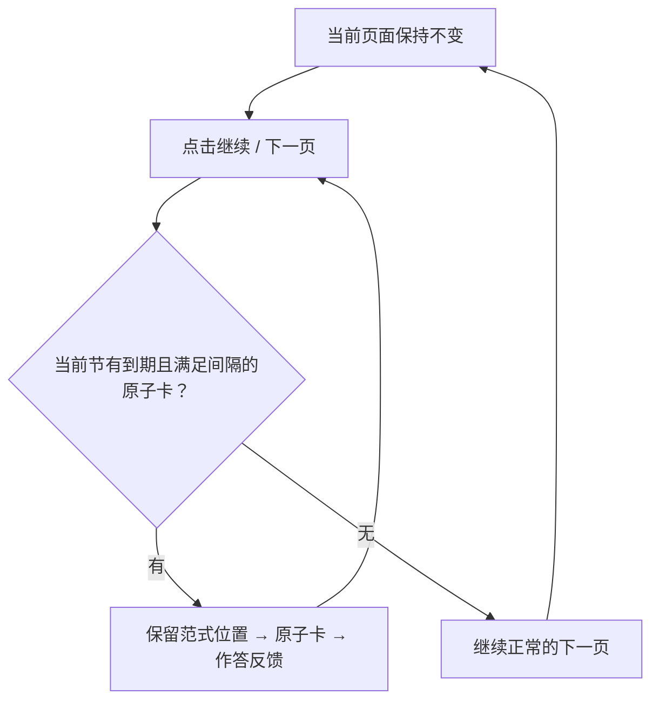

# 同一 Topic 内的原子提取与范式训练

Topic 由按原稿顺序排列的 Introduction 节组成。每节可以包含知识组块、原子记忆点和原子卡，也可以包含 Example 及其 Practice。两部分都存在时按以下顺序学习；不存在的部分及其统计不显示。

知识组块包含原子记忆点，卡片引用记忆点。先呈现对应组块，再呈现原子卡，不同组块按既有规则交错。原子记忆状态属于记忆点，范式记忆状态属于 Example 模块，二者分别保存。

每个记忆点初学答对后移出初学队列，不要求做完所有变式。初学答对不评分，首次复习在六小时后；初学答错、正式复习、同组块三分钟间隔、变式轮换和多点打包沿用既有规则。

高阶学习者开启自主评分后，原子复现题显示答案时提供第五档“极度熟悉，不必再练”。该操作持久停止当前卡所关联记忆点的后续推送，所有变式及包含这些点的打包卡一并退出推送；不向 FSRS 传入评分 5，不影响其他记忆点，刷新和重启后仍有效。

本节没有当前可推送的卡片时，进入本节范式训练；本节新内容走完后，继续下一 Introduction。未掌握但尚未到期、或尚未满足组块间隔的卡，不阻挡后续内容。只有当前 Introduction 的原子卡可以穿插到本节后续 Example / Practice 中：

- 到期只影响下一次向前推进，不替换已加载的页面，不自动提交答案。
- 插卡不消耗尚未展示的 Practice，不重开 Example 轮次。连续点击、刷新、判题重试和重启恢复沿用事务、修订号及请求幂等保护。
- 已进入范式训练时，尚未满足三分钟间隔的卡不阻挡下一页；之后翻页重新检查。
- 进入下一 Introduction 后，上一节卡片不再插入当前学习流程。它们仍保留记忆状态及独立复习资格。
- 阅读知识组块时可以回看本节指导；进入原子卡作答及反馈页面时隐藏整个左侧目录，离开原子卡页面后恢复。组块页的训练按钮下显示“请确保已理解该内容，开始训练后不可再回看知识”。
- 范式错题自动暂停只暂停范式训练，不暂停原子记忆点及其复习。两套状态不能互相覆盖。
- 全部后续内容走完后，继续完成尚未掌握的原子初学，保留原有到期时间与组块间隔；不会把跳过等待误计为掌握或首轮完成。之后到期的复习不会撤销首轮完成记录。

旧 Topic 使用同一内容结构投影，同时保留原有学习行为与身份：

- 纯范式 Topic 保留 Example 掌握选择优先、需要时阅读指导的流程。
- 纯原子 Topic 保留原子初学、卡片历史和独立复习流程。
- 纯 Introduction 保留引论阅读与版本更新后的重读机制，不产生 FSRS 卡。
- 不迁移或重新编号旧 Topic、Introduction、Example、记忆点和卡片，不重置正式学习进度。

验收涵盖单节混合、多节混合、某节缺少其中一套内容、三类旧 Topic、翻页插卡与返回位置、动态指导锁定、跨节退出、分别暂停、复习去重、并发提交和重启恢复。

## 内容接口

沿用 Topic v2 的 `introductions`、`content_order`、`modules`，同时允许 `memory_chunks`、`flashcards` 和 `atomic_policy`。不新增第三种互斥训练模式；是否存在相应内容决定启用哪些训练能力。旧 `training_mode` 字段作为兼容输入保留，不能排斥另一套内容。

多 Introduction 时，每个知识组块必须用 `introduction_id` 指向所属指导。批注位置相对于这节指导校验，不允许根据标题猜测归属。单 Introduction 的旧组块无需补字段。Example 继续归属原稿中前面最近的 Introduction；卡片继续通过 `point_ids` 引用记忆点。跨节打包卡可用于独立复习，但不会跨越当前节的插卡范围。

原子内容和 Example 共享 Topic、权限、提交记录与事务；原子进度保存在同一学习记录的 `atomic` 部分。旧记录保持原样，由共同的内容投影兼容读取，不批量改写生产学习数据。复习卡的身份仍由原 Topic、内容版本和记忆点确定。
